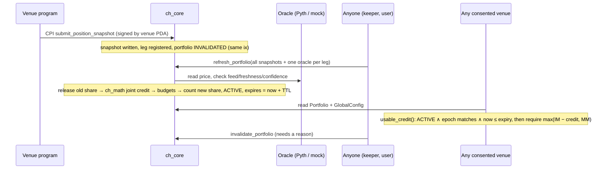

# Architecture

## Components

```
clearinghouse/
  programs/ch_core        the protocol (Anchor 1.2.0): accounts, governance, venue auth, oracle, credit
  crates/ch_math          pure integer engine: joint risk, stressed model, credit, caps (no dependencies)
  crates/ch_client        venue-side rules: usable_credit, effective_initial_margin, withdrawable_equity
  programs/mock_perps_a/b MOCK venues: report positions by CPI (prove the production auth path)
  programs/ch_fund        STUB (no loss coverage; see FUND_DESIGN.md)
  services/keeper         optional liveness bot: refresh / release, role-less
  testbench               localnet UI + independent verification + smoke test
  crates/ch_svm_tests     instruction-level tests on the compiled .so (LiteSVM)
  tests/ch_core.ts        Anchor TS integration tests (validator; CI)
```

`ch_core` calls `ch_math` directly, so on-chain credit is the same code the
property, stress and parity tests exercise. The TypeScript port
(`testbench/src/portfolio.ts`) is held bit-identical by shared JSON vectors.

## Data flow



## State and invalidation

Credit is usable only while **all** of these hold, so invalidation is O(1)
whatever the number of users:

| Condition | Changed by | Effect |
| --- | --- | --- |
| `portfolio.status == Active` | any snapshot write or close, any consent change, a justified `invalidate_portfolio` | that user only, same instruction |
| `portfolio.risk_epoch == config.risk_epoch` | any parameter change, risk-model change, venue activation or deactivation, `bump_risk_epoch` | every user at once (counters reset) |
| `now ≤ portfolio.expires_slot` | time (`credit_ttl_slots` ≤ 3,000) | that user |

Outstanding-credit counters (global, per venue, per asset) are adjusted
exactly once per computation. `release()` runs before every recompute, on
invalidation and on account close. An epoch bump zeroes all counters, since every
share counted in an older epoch is void.

## Roles

| Role | Scope |
| --- | --- |
| admin | roles, unpause, admin transfer; mock prices on localnet |
| risk_authority | parameters, correlations, asset risk, stress, scenarios, oracle feeds: bounded, step-limited; credit-increasing changes wait `timelock_slots` |
| venue_manager | register, activate (after the timelock), deactivate venues |
| guardian | pause refresh, deactivate venues, cancel a queued change, bump the epoch: everything it can do only removes credit |
| anyone | refresh, justified invalidation |

## Build configurations

| Features | Use |
| --- | --- |
| `mock-oracle,dev-venue-signer` | localnet, LiteSVM suites, `anchor test`, testbench |
| `mock-oracle,venue-cpi` | CPI-auth LiteSVM suite (`target/deploy-cpi`) |
| `pyth,dev-venue-signer` | Pyth LiteSVM suite (`target/deploy-pyth`) |
| `pyth,venue-cpi` | **production** (`target/deploy-prod`; built in CI, never deployed) |

Any other combination fails to compile (checked in CI).

## Key design decisions

- **Joint, not pairwise** (F3): one computation over every leg a user has, on
  every consented venue.
- **Risk is notional × shock, not margin** (F1): venues' IMs only scale the
  credit; the risk number comes from the governed model.
- **Trading power only** (F1/F6): credit ≤ `IM − MM`, never collateral, so
  revoking it is never itself a liquidation trigger. That makes aggressive
  invalidation safe.
- **Permissionless and deterministic** (F14): nobody has to be trusted to
  compute credit; keepers only provide liveness.
- **Fail closed**: missing feature choice, missing oracle feed, missing
  snapshot, stale input or unsupported asset each mean no credit.
