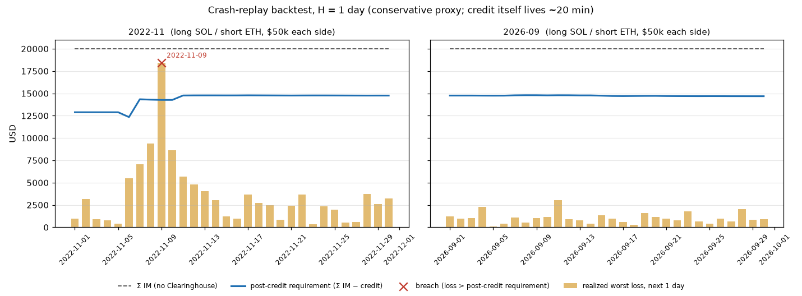
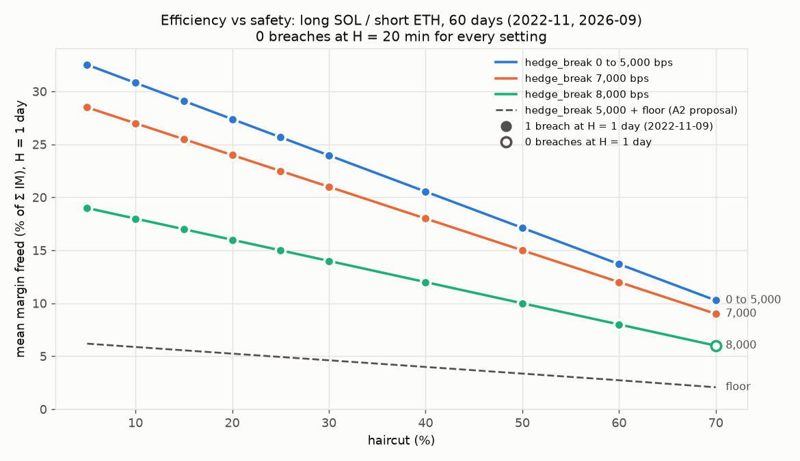

# Crash-replay backtest

Does the post-credit requirement cover what a hedged book actually lost? This
page answers that for one book, on two months of data, with one breach found.
Status: [`STATUS.md`](STATUS.md).

**Every number on this page** comes from

```bash
cd services/risk && npm run backtest      # tables; writes docs/backtest/results.json
python -I scripts/backtest/chart.py docs/backtest/results.json docs/backtest/backtest.png
```

or from `scripts/backtest/run.sh`, which runs the tests and then both commands.
The output is byte-identical across runs (checked with `cmp`), and the tests
assert determinism.

## Horizon caveat (read first)

Credit lives about 20 minutes (`credit_ttl_slots` ≤ 3,000 slots), and the
price guard can invalidate it sooner. The **primary horizon here is
H = 1 day**, a deliberately **conservative proxy**: the book is assumed to
sit for a full day on parameters and credit fixed at the open. **This is not a
validation at the credit's own horizon.** A supplementary run at H = 20
minutes uses 20-minute bars (open, high, low, close), **not minute data**. The
price guard (`max_move_bps`) is **not** modelled in either run.

## Setup

| Item | Value |
| --- | --- |
| Book | long SOL, short ETH, $50,000 notional each side at the day's open; IM 20% ($10,000), MM 10% ($5,000) per leg; venue 0 and venue 1 |
| Data | Binance spot 20-minute klines, SOLUSDT/ETHUSDT, 2022-11 and 2026-09 (provenance: [`crates/ch_math/tests/data/README.md`](../crates/ch_math/tests/data/README.md)) |
| Evaluation days | every UTC midnight with a full horizon of bars: 60 days (30 + 30) |
| Credit engine | `testbench/src/portfolio.ts`, the TypeScript port of `ch_math`, bit-identical to Rust through the shared vectors. Same model as `ch_core` (no hedge-break scenario, no governance scenarios set). A second column adds the calibrated hedge-break scenario (M3, off-chain) |
| Credit params | haircut 20%, per-leg cap 75% of IM and `IM − MM`, per-user cap $100,000 (`services/risk/params/localnet.json`) |
| Initial risk params | localnet defaults: SOL 10%/10%, ETH 8%/8%, ρ = 0.8, δ = 0.1, β = 0.02 |
| Sanity check | at the initial params the engine gives **7,111,111,110** micro-USD, the worked-example value pinned in the vectors and the LiteSVM suite (`npm test`, "engine sanity") |

**Parameters known up to each date, no look-ahead.** Governance runs the
calibration ([`services/risk`](../services/risk/README.md)) once a day, using
only bars that **closed before d − 1 day**. The production timelock is
≥ 216,000 slots (~1 day), so a change proposed from data up to d − 1 day takes
effect at d at the earliest. Each update is clamped to the on-chain bounds and
step limits relative to the previous day's parameters. Until there is enough
data (4 days), the initial params stay in force. This is asserted in code:
`runBacktest` throws if a calibration bar closes after the cutoff, and
`calibrate` re-checks it. Two tests prove it:
- "no look-ahead": corrupting every bar after 2022-11-15 leaves every earlier
  day's parameters and credit unchanged, and does change later days;
- "data cutoff ≥ one timelock before use".

A mutation that lets calibration see the evaluation day fails both tests.

**Metric.**

```
post-credit requirement = Σ IM − credit
realized loss           = worst mark-to-market loss of the book over [d, d + H),
                          from the opening prices at d, combining the SOL low and
                          the ETH high of the same bar (conservative; a closes-only
                          figure is reported alongside)
breach (with CH)        = realized loss > post-credit requirement
breach (baseline)       = realized loss > Σ IM          (no Clearinghouse)
margin of safety        = post-credit requirement − realized loss
```

## Results

### H = 1 day (conservative proxy)

| sample | days | breaches with CH | with CH + hedge-break | baseline (Σ IM only) | worst margin of safety (with CH) |
| --- | ---: | ---: | ---: | ---: | --- |
| all days | 60 | **1** | 1 | 0 | **−$4,166.38** (2022-11-09) |
| 2022-11 | 30 | 1 | 1 | 0 | −$4,166.38 (2022-11-09) |
| 2026-09 | 30 | 0 | 0 | 0 | $11,758.01 (2026-09-11) |



### H = 20 minutes (bar-level supplementary, not minute-level)

| sample | windows | breaches with CH | with CH + hedge-break | baseline | worst margin of safety (with CH) |
| --- | ---: | ---: | ---: | ---: | --- |
| all windows | 4,320 | 0 | 0 | 0 | $4,976.76 (2022-11-08 19:20 UTC) |
| 2022-11 | 2,160 | 0 | 0 | 0 | $4,976.76 |
| 2026-09 | 2,160 | 0 | 0 | 0 | $11,937.37 |

### The breach

| date | params in force (data cutoff) | SOL / ETH shock | R_p | credit | post-credit req | realized loss | loss (closes) | SOL | ETH | with CH | baseline |
| --- | --- | --- | ---: | ---: | ---: | ---: | ---: | ---: | ---: | --- | --- |
| 2022-11-09 | calibrated (2022-11-08) | 17.43% / 9.73% | $8,715.00 | $5,731.96 | $14,268.04 | **$18,434.42** | $16,951.07 | −42.25% | −17.38% | **BREACH** | ok |

**Clearinghouse turned a covered day into a breach.** Σ IM ($20,000) would
have covered the loss; Σ IM − credit ($14,268) did not.

**Why.**

1. **The model in force had never seen a crash.** The parameters on
   11-09 were calibrated from 1–7 Nov 2022 only, which was quiet before the FTX
   collapse. The SOL shock was 17.43%. On 11-09 SOL fell 42.25% from the open
   while ETH fell only 17.38%, so the short ETH leg hedged less than half of
   the SOL loss. R_p ($8,715) was less than half the realized loss. That is
   a model miss, not a calculation error.
2. **The hedge-break scenario did not help.** For this book the SOL gap
   scenario dominates it at the calibrated fraction, so the credit with
   hedge-break equals the credit without.
3. **Larger shocks alone would not have helped either.** With gap = shock and
   equal notionals, credit = Σ IM · (1 − R_p/S) · (1 − haircut). That depends
   on the *ratio* of the shocks, not their level. Scaling every shock and gap
   by 2 or 4 leaves this book's credit at exactly $7,111.11, even at 4× where
   R_p equals Σ IM (test "documented limitation: scaling every shock…").
   Likewise, the parameters in force at the end of the sample (SOL 42.95%,
   ETH 21.37%, calibrated from data that includes this crash) still give
   $5,315.92 of credit (HYPOTHETICAL rows below). See
   [`KNOWN_LIMITATIONS.md`](KNOWN_LIMITATIONS.md).
4. **Step limits slowed the reaction.** After the crash, a shock may at most
   double per update. The SOL shock went 17.43% → 34.86% → 48.10% over the
   next two days.

**At the credit's own horizon there was no breach.** At H = 20 minutes the
worst window (2022-11-08 19:20 UTC) kept a margin of $4,976.76. This does
**not** validate the 1-day result away: it only says the conservative proxy is
where the failure shows.

### Historical replay: 2–15 November 2022

| | value |
| --- | --- |
| Window | book opened 2022-11-02 00:00 UTC, held to 2022-11-15 24:00 UTC (14 days; **not** one margin horizon) |
| Params in force at open | initial (no calibration data yet) |
| Σ IM / credit / post-credit requirement | $20,000.00 / $7,111.11 / $12,888.89 |
| Worst loss over the window | $19,557.37 (closes: $18,414.13) |
| With CH / baseline | **BREACH** / ok |

**The quoted figures, checked against the CSVs.** The reported moves for
2–15 Nov 2022 were SOL ≈ −54% and ETH ≈ −20%. The data gives:

| measurement | SOL | ETH |
| --- | ---: | ---: |
| daily CSV, close 11-01 → close 11-15 | −55.53% | −20.61% |
| daily CSV, close 11-02 → close 11-15 | −53.51% | −17.46% |
| 20-minute klines, open 11-02 00:00 → close 11-15 23:40 | −55.53% | −20.60% |

The quoted pair matches neither convention exactly: SOL ≈ −54% fits the
11-02 close, and ETH ≈ −20% fits the 11-01 close (equivalently the 11-02
open). Measured over one consistent window (11-02 open → 11-15 close), the
figures are **SOL −55.5%, ETH −20.6%**.

### HYPOTHETICAL: decorrelation shock

**HYPOTHETICAL. These moves were chosen, not observed:** SOL −30% and ETH +15%
within one day, so the two hedge legs both lose.

| parameters | loss | Σ IM | credit | post-credit req | with CH | with CH + hedge-break | baseline |
| --- | ---: | ---: | ---: | ---: | --- | --- | --- |
| initial (localnet) | $22,500.00 | $20,000.00 | $7,111.11 | $12,888.89 | BREACH | BREACH | BREACH |
| calibrated, in force 2026-09-30 | $22,500.00 | $20,000.00 | $5,315.92 | $14,684.08 | BREACH | BREACH | BREACH |

Neither venue margin alone nor margin minus credit covers a decorrelation of
this size. Clearinghouse makes the shortfall larger by exactly the credit.

## Efficiency-vs-safety frontier (B1)

**Every number in this section** comes from

```bash
cd services/risk && npm run frontier     # table; writes docs/backtest/frontier.json
python -I scripts/backtest/frontier_chart.py docs/backtest/frontier.json docs/backtest/frontier.png
```

(run 2026-10-12; tested by `services/risk/src/frontier.test.ts`, which checks
that the setting in force reproduces the backtest above). The same 60 days and
4,320 windows are used, with the calibrated risk parameters in force each day.
Only `haircut_bps` and `hedge_break_bps` are swept. "Freed" is the mean of
credit / Σ IM. It is the same at H = 20 minutes as at H = 1 day, because
parameters change once a day and credit does not depend on the horizon.



| haircut | hedge_break | freed (% of Σ IM) | breaches H = 1 day (per day) | breaches H = 20 min (per day) | with floor (A2): freed | with floor: breaches H = 1 day |
| ---: | ---: | ---: | ---: | ---: | ---: | ---: |
| 500 | 0 – 5,000 | 32.52 | 1 (0.0167) | 0 (0) | 6.18 | 1 |
| 1,000 | 0 – 5,000 | 30.80 | 1 (0.0167) | 0 (0) | 5.87 | 1 |
| **2,000** (in force) | 0 – 5,000 | **27.38** | 1 (0.0167) | 0 (0) | 5.24 | 1 |
| 3,000 | 0 – 5,000 | 23.96 | 1 (0.0167) | 0 (0) | 4.61 | 1 |
| 5,000 | 0 – 5,000 | 17.11 | 1 (0.0167) | 0 (0) | 3.35 | 1 |
| 7,000 | 0 – 5,000 | 10.27 | 1 (0.0167) | 0 (0) | 2.06 | 1 |
| 2,000 | 6,000 | 26.98 | 1 (0.0167) | 0 (0) | 4.84 | 1 |
| 2,000 | 7,000 | 23.99 | 1 (0.0167) | 0 (0) | 3.68 | 1 |
| 2,000 | 8,000 | 15.99 | 1 (0.0167) | 0 (0) | 2.40 | 1 |
| 6,000 | 8,000 | 7.99 | 1 (0.0167) | 0 (0) | 1.20 | 1 |
| 7,000 | 8,000 | **6.00** | **0** | 0 (0) | 0.90 | 0 |

All 80 settings are in `docs/backtest/frontier.json`. Every setting with
`hedge_break_bps` from 0 to 5,000 gives identical numbers: for this book the
SOL gap scenario dominates.

**What the frontier says.**

1. **The breach does not depend on these two parameters.** The 2022-11-09
   breach survives every haircut up to 60% and every hedge break up to 8,000.
   Of the 80 settings, only haircut 70% with hedge break 8,000 avoids it, and
   that setting frees 6.00% of Σ IM, compared with 27.38% today (78% less).
   The breach is a model miss (point 1 of "The breach"), not a tuning problem.
2. **H = 20 minutes: 0 breaches at every setting.**
3. **The floor (A2) costs most of the credit and removes no breach.** At the
   setting in force, mean freed margin falls from 27.38% to 5.24%. The
   calibrated shocks make the model's standalone risk larger than the venues'
   20% IM, so `Σ IM − R_p` is small (KNOWN_LIMITATIONS #19). That is the floor
   doing its job, but on this data its price is about 81% of the credit.
4. **Hedge break up to 5,000 is free on this book.** It only costs on books it
   is designed for (same-asset basis trades, RISK_MODEL §3a).

**Recommended default: haircut 2,000 bps, hedge_break 5,000 bps.** This is
judgement, not an optimum. Within the range that frees useful margin, neither
parameter changes the breach count, so the haircut stays where it is.
`hedge_break` goes to 5,000 because it costs nothing here and caps basis-trade
credit independently of ρ. The breach has to be addressed through the model
inputs (longer crash history, B2; the regime throttle, B3), not through these
two parameters.

## Proposed changes (not applied)

The breach is reported as found. **No parameter was changed to make it go
away.** Proposals, each evaluated by the same command:

1. **Engine floor `credit ≤ (Σ IM − R_p)⁺`.** This would close the
   scale-invariance gap in point 3: once the model believes the book can lose
   Σ IM, it gives no credit. Evaluated here as a column (`PROPOSAL`): it
   removes **0 of 1** breaches at H = 1 day, because on 11-09 the model in
   force underestimated R_p (point 1). It is a change to `ch_math` and
   `ch_core` semantics (vectors, both engines, the approval gate in
   [`WORKFLOW.md`](WORKFLOW.md) §4), and it is proposed for its own reasons,
   not as a fix for this breach.
2. **Seed calibration with history beyond the two committed months** (for
   example 2020-03 and 2021-05 crashes) before the first credit is issued, so
   day one does not run on a calm week's quantile. That needs new data, which
   needs network access and your approval.
3. **What a parameter-only fix would take, for scale:** removing the 11-09
   breach with the current formula requires a haircut of at least
   **78.15%** (7,815 bps; 2,000 bps in force), computed by binary search on
   the engine in `npm run backtest`. That would remove most credit on every
   day. It is **not recommended**, and it is stated only to show that this
   breach is not a tuning problem.

## Limits of this backtest

- One book, one pair, two months, 60 daily evaluations. Daily observations
  overlap with the calibration windows; nothing here is a statistical test.
- Spot prices from one venue. No perpetual marks, funding, or cross-venue
  basis; basis parameters are not estimated.
- Losses combine the SOL low and the ETH high of the same 20-minute bar.
  That is conservative, because the two need not coincide.
- Liquidation, slippage and time-to-liquidate are not modelled. A "breach"
  means the requirement did not cover the mark-to-market loss, not that a
  venue lost money.
