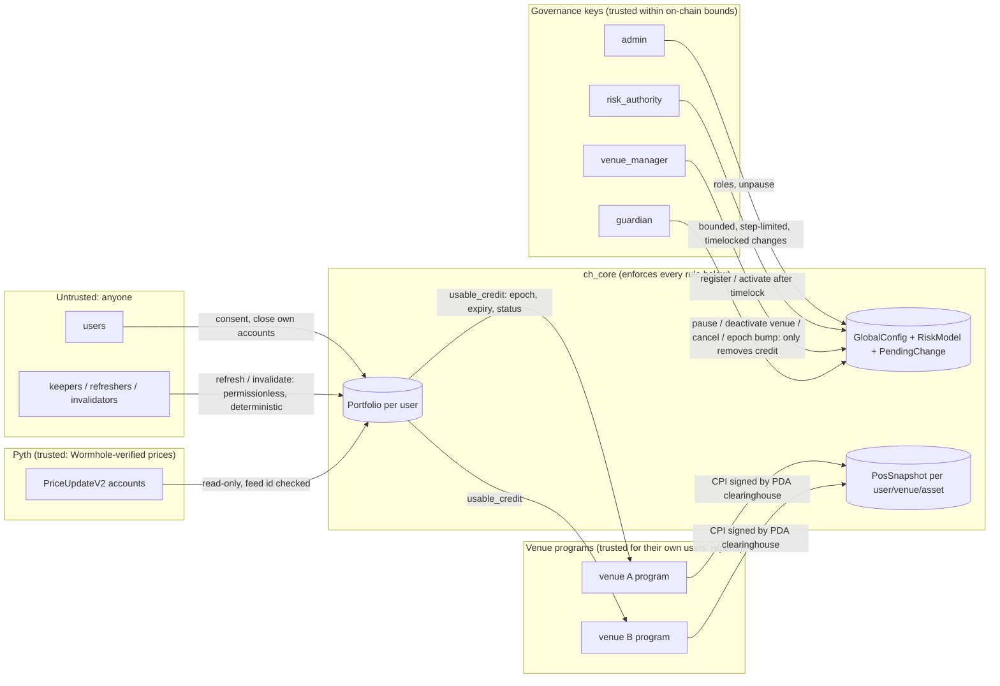

# Threat model

Scope: `ch_core` in its production configuration (`pyth,venue-cpi`), the
venue-side rule in `ch_client`, and the keeper. The testbench and mock venues
are localnet tools and out of scope except where noted. Status of each
mitigation: [`STATUS.md`](STATUS.md). Remaining gaps:
[`KNOWN_LIMITATIONS.md`](KNOWN_LIMITATIONS.md).

## What is being protected

1. **Venues' solvency.** Credit lowers a venue's initial-margin requirement,
   so too much credit means too little margin.
2. **Users' positions.** Losing credit must never by itself liquidate anyone.
3. **The integrity of credit.** Credit must correspond to the current inputs:
   positions, consent, parameters, risk model and prices.
4. **Liveness.** Credit should be refreshable by anyone. When it can't be, it
   must stop being usable, not stay stale.

## Trust boundaries

Plain-text summary of the arrows: governance writes config within hard bounds.
Venue programs write only their own snapshots, by CPI. Users write their own
consent. Anyone can refresh or invalidate. Pyth is read and checked against a
governed feed id. Venues read credit and apply `max(IM − credit, MM)`.

## Actors and what each can do at worst

| Actor | Can | Cannot (enforced) |
| --- | --- | --- |
| **Anyone** | refresh any portfolio; invalidate with a valid reason; pay fees | create credit the deterministic computation would not give; invalidate correct credit without a reason (`InvalidationNotJustified`); trip credit with an older genuine oracle update (evidence must postdate the baseline) |
| **User** | consent / revoke per venue; close own accounts once snapshots are closed; close a snapshot for a venue they no longer consent to | write positions; close others' accounts (seeds bind the signer) |
| **Venue program** | report any position for users who consented to it; choose which venues it accepts credit from | report for a venue id registered to another program (PDA check, `venue-cpi`); report for non-consenting users; register itself; keep credit alive after a report (every write invalidates); raise the credit another venue applies unless that venue allowlisted it (A1); change another venue's allowlist |
| **Compromised venue hot key** | nothing, in production: the authority is a program PDA with no private key | (with `dev-venue-signer`, a key is the authority; localnet only, compile-time exclusive) |
| **risk_authority** | change parameters and the model within bounds; credit-increasing changes take ≥ 216,000 slots (~1 day) and are visible on chain before they apply | set haircut < 5%, credit > 90% of IM, shocks < 1%, move ρ by > 0.25 or a shock by > 2× in one change, or skip the timelock |
| **venue_manager** | register venues (inactive until the timelock passes); deactivate | activate a venue immediately (production) |
| **guardian** | pause refresh; deactivate a venue; cancel a queued change; bump the epoch | unpause, change parameters, add credit |
| **admin** | set roles, unpause, transfer admin (two-step) | bypass bounds or timelock (no admin override exists); in production, hold another role or collapse two roles into one key (A7, `production_roles.rs`) |
| **Pyth / Wormhole** | publish prices | supply a price for a different feed (feed id checked) or a partially verified update (Full only) |

## Threats and mitigations

| # | Threat | Mitigation | Evidence |
| --- | --- | --- | --- |
| T1 | Over-credit by computing pairs separately (F3) | one joint computation per user; per-user, per-venue, per-asset and global caps | `ch_math` F3 regression; `portfolio.rs` cap tests |
| T2 | Stale credit after an input change (F2) | snapshot write/close and consent change invalidate in the same instruction; parameter/model/venue changes bump the epoch | LiteSVM invalidation tests; mutation checks |
| T3 | Baseline reset by re-reporting (F5) | baseline price, confidence and publish time live in the portfolio | `f5_resubmitting_a_snapshot…` |
| T4 | Losing credit liquidates a user (F1, F6) | credit ≤ `IM − MM` per leg; venue applies `max(IM − credit, MM)`; `TradingPowerOnly` kind checked by `usable_credit` | `ch_client` tests; engine caps |
| T5 | Risk measured as margin, crash under-covered (F1) | stressed model: notional × shock, direction-aware correlation stress, market-wide/gap/basis/governance scenarios | stress suite, Nov-2022 replay ([RISK_MODEL](RISK_MODEL.md)) |
| T6 | Rogue or careless risk key (F7) | bounds, step limits, timelock for credit-increasing changes, guardian cancel, epoch bump on apply | `governance.rs` unit tests, `tests/governance.rs` |
| T7 | Venue index collision / re-registration (F8) | `init`-only registration, uniqueness by index bit | `venue_registry.rs` (failed against v0 binary) |
| T8 | Mock oracle in production (F9) | no default feature; compile error unless exactly one backend | CI must-fail feature checks |
| T9 | Venue hot-key compromise (F10) | `venue-cpi`: authority = venue program PDA | `venue_cpi.rs` |
| T10 | Oracle evidence replay / cherry-picking | invalidation evidence must postdate the baseline; feed id per asset; Full verification | `pyth_oracle.rs`, mutation check |
| T11 | Counter drift / double counting | exactly-once release on refresh, invalidate, close; epoch bump zeroes counters | invariant tests; keeper two-instance test |
| T12 | Account revival / reinitialization | venues never closed; snapshots `init_if_needed` with identity re-checks; user accounts closable only with no snapshots; re-creation starts EMPTY | `account_lifecycle.rs` |
| T13 | Keeper failure or misbehaviour (F14) | keeper is optional and role-less; credit expires within ≤ 3,000 slots | keeper tests |
| T14 | Testbench used against a real cluster | loopback-only RPC, dev server bound to 127.0.0.1, banner | `verify.test.ts`, `ui.test.tsx` |
| T15 | A misreporting venue creates credit that another venue applies (H3) | A1: per-venue allowlists, default "own reports only"; credit = min(joint, view over accepted venues); revoking voids affected credit in the same instruction | `view_props.rs` `prop_view_credit_bounds_order_and_untrusted_reports`, `malicious_fake_offset_cannot_raise_a_non_allowlisting_venue`; LiteSVM `allowlist.rs` (7 tests, incl. `malicious_venue_fake_offset_gives_zero_to_non_allowlisting_venue`, `unallowlisting_removes_credit_in_the_same_instruction`); `venue_cpi.rs` `acceptance_is_set_only_by_the_venue_programs_pda` |
| T16 | Credit independent of risk level: post-credit requirement below R_p | A2: credit ≤ (ΣIM − R_p)⁺ | `portfolio_props.rs` `prop_floor_post_credit_requirement_never_below_portfolio_risk`; `non_psd.rs` `floor_closes_the_gap_when_im_is_below_standalone_risk`; 2 parity vectors |
| T17 | A wrong correlation matrix inflates credit | A3: ρ-independent hedge-break scenario on-chain (min 2,500 bps in production); A4: integer positive-definiteness check, ρ-free fallback (credit 0) | `governance.rs` `hedge_break_*` (LiteSVM), `portfolio.rs` `same_asset_basis_trade_credit_matches_engine_with_hedge_break`, `non_psd_correlation_gives_zero_credit_and_sets_flag`; `non_psd.rs` (20,000 matrices, all 10,771 non-PSD sub-matrices fall back) and `psd_matches_float_classifier_near_singular` |
| T18 | Oversized or suddenly grown fake positions | A5: per-leg and per-(user, venue) notional caps, growth limit per window, optional mark price vs oracle | LiteSVM `report_bounds.rs` (5 tests: one per error plus boundaries) |
| T19 | One person controls several governance roles | A7: production builds require four distinct role keys in `initialize`, `set_roles`, `accept_admin` | LiteSVM `production_roles.rs` (3 tests on the production build); `governance.rs` unit `roles_must_be_four_distinct_non_default_keys` |
| T20 | Counter drift or invariant break under unusual sequences | A8: seeded random-sequence test, invariants after every step | `stateful.rs` (32 seeds × 300 steps) |
| T21 | Tests that cannot fail | A9: mutation checks for every new rule | `scripts/ci/mutate.py`, results in TESTING_AND_CI |
| T22 | Refresh too expensive to run, so credit goes stale | measured CU; keeper adds a ComputeBudget limit for books with partial views; failure is safe (credit expires) | `perf.rs` (asserts ≤ 200k for the common cases and ≤ 1.4M for the worst view case); keeper `budget.test.ts` |

## Residual risks (not mitigated here)

- **Venues trust the reports of venues they allowlist (A1).** A venue that
  misreports for a user (for example a fictitious offsetting short) can no
  longer raise the credit applied by venues that did not allowlist it: each
  leg's credit is `min(joint, view)`, and the view contains only accepted
  venues (`ch_math` property test over 4,000 random books; LiteSVM
  `malicious_venue_fake_offset_gives_zero_to_non_allowlisting_venue`).
  Whoever **does** allowlist a dishonest venue is exposed to it, bounded per leg
  by `IM − MM` and by the caps. Nothing verifies positions themselves. A5 adds
  sanity bounds that need no new trust: a per-leg notional cap, a per-(user,
  venue) cap, a growth rate per window, and an optional mark price checked
  against the oracle (`report_bounds.rs`). They bound how large and how fast
  a fake leg can be. They cannot prove a position exists: a fake new leg up
  to the growth floor and the caps is still possible, and the mark price
  says nothing about size.
- **Governance judgement.** Bounds limit the damage, but parameters inside the
  bounds can still be wrong. The timelock gives observers about a day to react
  (cancel, pause, or users revoking consent).
- **Refresher's price choice.** On refresh, any genuine update within
  `max_price_age_secs` may become the baseline. It affects only the price
  guard, not the credit amount.
- **No loss coverage.** No default fund exists. Venues carry their own
  liquidation risk.
- **Upgrade authority.** Whoever holds the program upgrade authority can change
  everything. Deployment must put it behind a multisig and timelock; the
  custody runbook is OPERATIONS §2b. The program cannot check this, nor that
  the role keys are multisigs (it only checks they are distinct, A7).
- **Unaudited.** No external audit has been performed.
